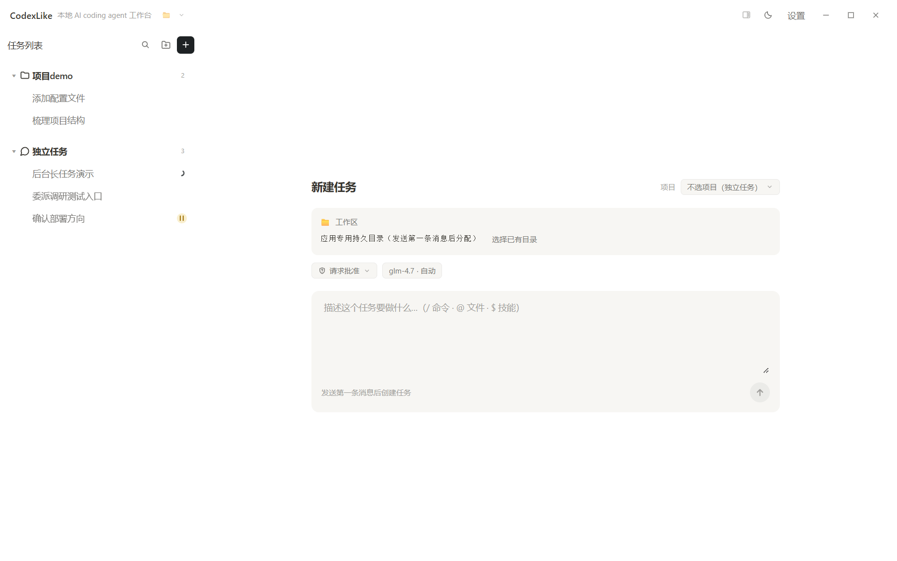
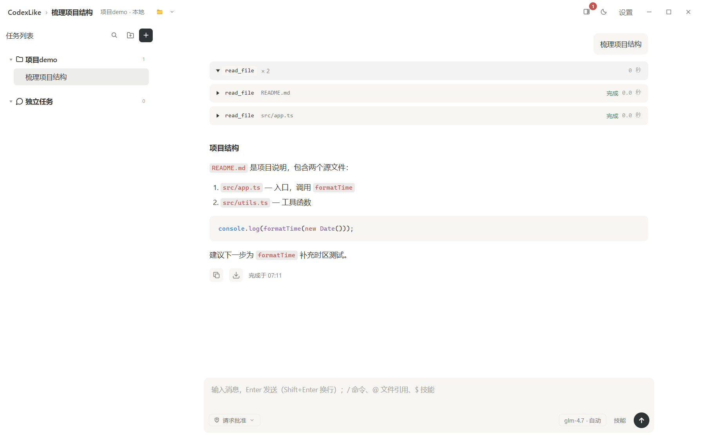
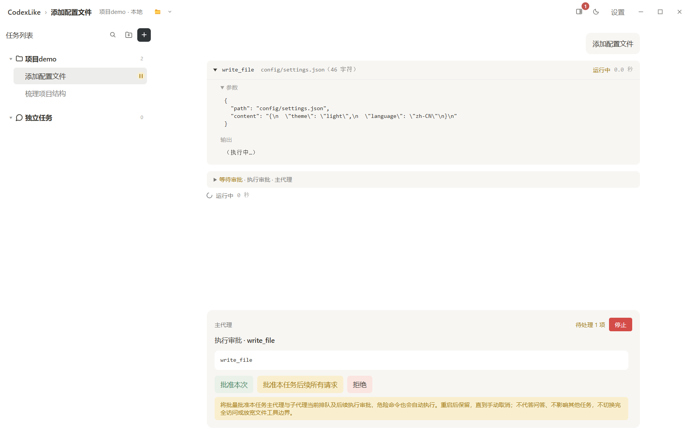
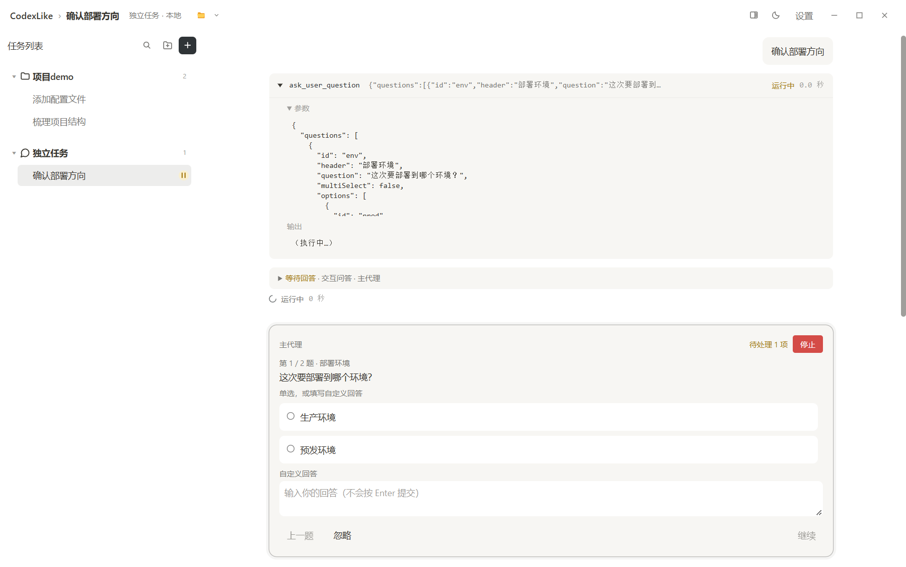
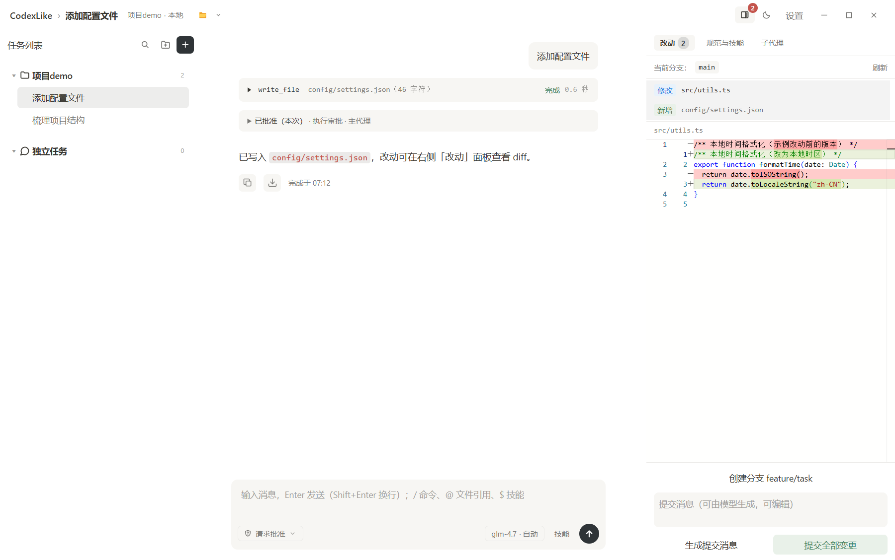
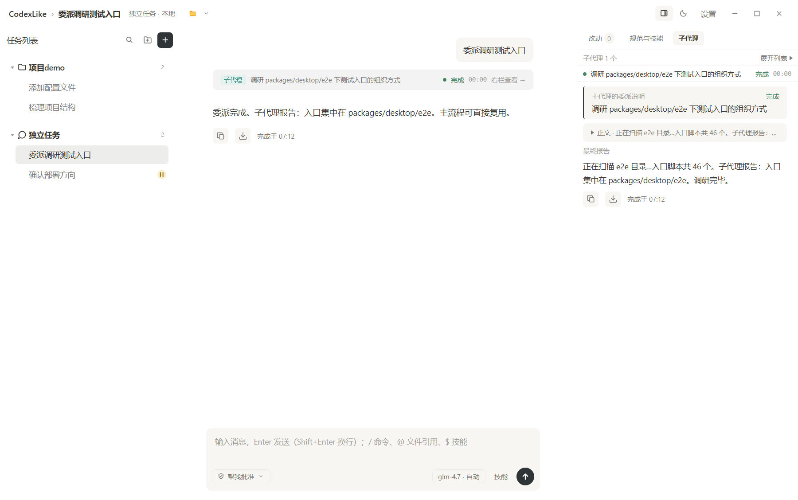
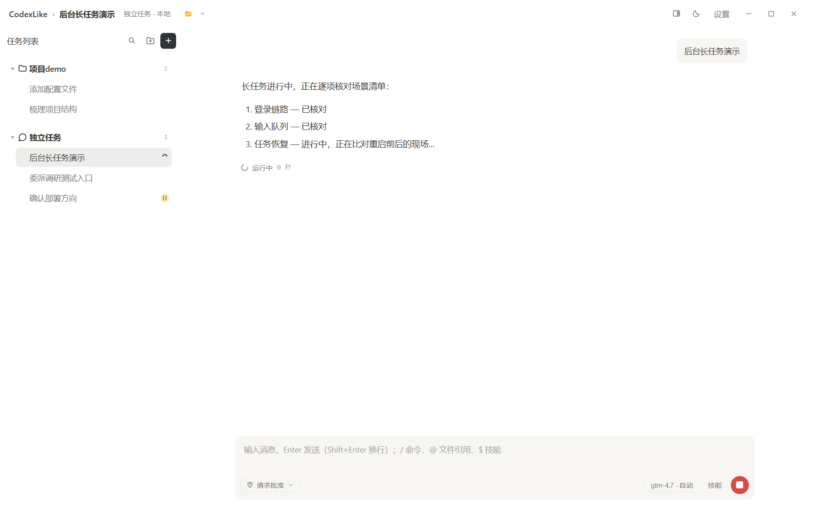
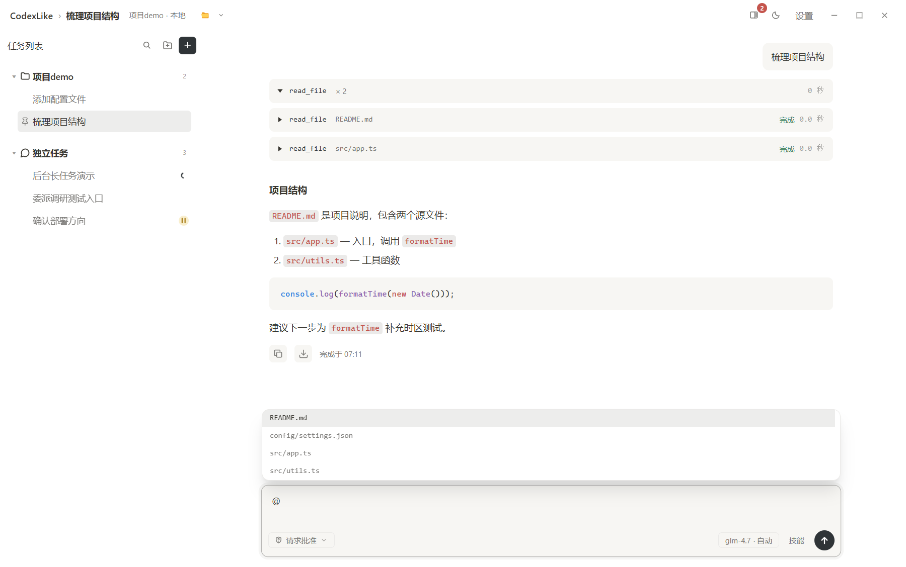
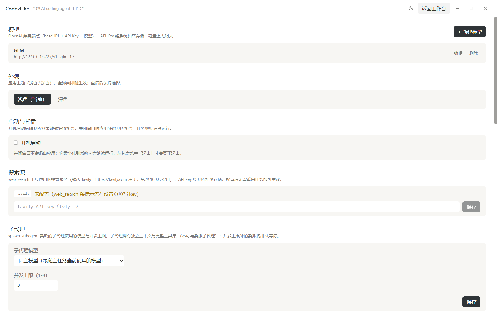

# CodexLike

本地 AI coding agent 桌面工作台（Electron，Windows 优先，全中文界面）：agent 在你本机的工作区里读文件、改代码、跑命令、搜网络，你通过界面审批与检视结果——一个自己可控的「Codex Desktop 功能平替」。

## 界面截图

### 新建任务

草稿先行：输入前只准备草稿，首次发送才创建任务与目录；可选已有工作区（或 Worktree）、审批模式与模型。



### 对话与工具调用

agent 自主读写文件、跑命令；工具调用以可展开卡片呈现，同名连续调用自动归组计数，正文 Markdown 渲染，随时打断。



### 三档审批模式

`ask` 模式下写入、联网与命令执行前在底部交互区询问；可批准本次、批准本任务后续所有请求，或拒绝。



### 对话内交互问答

agent 通过 `ask_user_question` 主动提问：逐题作答，支持预设选项、自定义回答与多选，主/子代理请求同区排队。



### git 集成

右栏改动面板：`git status` 变更列表 + Monaco 行内 diff（红删绿增）；一键创建任务分支、模型生成可编辑的提交消息。



### 子代理委派

`spawn_subagent` 委派调研：消息流嵌套卡片跟踪进度，右栏查看完整报告；子代理独立上下文、不可再递归委派。



### 任务工作台

项目与独立任务两组并行执行，运行中/等待用户状态实时可见，切回任务立即恢复现场。



### 输入区

`@` 引用工作区文件、`$` 按需选择技能、`/` 斜杠命令（`/new` `/compact` `/model` 等）。



### 设置页

任意 OpenAI 兼容端点多 Profile 管理，API key 经 Windows DPAPI 加密落盘；搜索源、子代理、托盘驻留等配置。



## 功能一览

- **任意 OpenAI 兼容端点**：多份 Provider Profile（`baseURL` / `apiKey` / `model`，GLM、DeepSeek、OpenAI、Ollama……），API key 经系统加密（Windows DPAPI）落盘，任务中随时切换。
- **任务与工具**：任务绑定工作区目录；agent 自主使用 `read_file` / `write_file` / `apply_patch` / `glob` / `grep` / `run_terminal_command`；工具调用以可展开卡片呈现；随时打断。
- **三档审批模式**：`ask`（请求批准，写入、联网和命令执行前询问）/ `assist`（帮我批准，仅危险命令询问）/ `full-access`（完全访问，自动执行并允许访问工作区外文件）。审批在底部交互区选择“批准本次 / 拒绝”，不记忆授权。
- **对话内交互问答**：agent 调用 `ask_user_question` 展示单选、多选或自定义回答，支持多题回看、单题忽略与整组提交；主代理和子代理请求与审批共用底部交互区，按任务排队并标明来源。
- **git 集成**：改动面板 `git status` + Monaco 双栏 diff；一键创建 `codexlike/<任务名>` 分支、模型生成（可编辑）提交消息并 commit。
- **任务工作台**：常驻侧栏分别组织独立任务和项目；空项目长期保留，普通非 Git 目录也可添加。新建先进入草稿，首次发送才创建历史与必要目录；项目归属与实际执行工作区分离。
- **现场与持久化**：多个任务并行执行，切回立即恢复正文增量、工具记录与待回应交互。SQLite 保存历史、普通/问答/新建草稿、阅读位置及各任务模型/思考/权限设置；设置修改只影响下一次发送，新任务从 `ask` 开始。
- **整理与查找**：置顶、最近使用排序、项目折叠、跨项目标题/正文搜索及归档查看恢复。最近使用仅由创建/发送更新，查看任务和后台输出不改变排序；归档、归属调整和项目移除不删除磁盘文件。
- **上下文管理**：全局与项目 `AGENTS.md` 每条消息自动刷新；全局/项目技能按需加载，输入框 `$` 显式选择技能、`@` 引用工作区文件；“规范与技能”查看来源和生效状态，`/compact` 压缩历史、`/status` 查看用量。
- **托管 Worktree**：项目草稿首次发送前可选 Worktree，发送时才创建隔离目录和分支；`.worktreeinclude` 声明需复制的被 ignore 文件。不再按数量自动清理，归档和移除项目均保留成果。同目录本地任务可并行，但提示共享文件风险。
- **扩展能力**：`web_search`（默认 Tavily）+ Playwright headless Chromium 浏览器工具组；stdio MCP server 逐工具启停；`spawn_subagent` 委派调研（嵌套卡片进度）。
- **斜杠命令**：`/new` `/rename` `/archive` `/compact` `/model` `/status`。

## 环境要求

- Windows 10/11 x64
- 保存凭据使用系统自带 Windows PowerShell 5.1 调用 DPAPI（CurrentUser）；若被企业策略禁用则明确拒绝保存，不改策略、不降级明文
- 使用终端命令工具需 Git Bash（默认探测常见安装路径）或 PowerShell/cmd
- MCP server、`node calc.js` 类命令依赖系统 Node.js（可选）
- 首次使用浏览器工具会自动下载 Chromium（默认走 npmmirror 镜像）

## 安装

发布产物在 `packages/desktop/release/`（由 `pnpm dist` 生成）：

| 产物                            | 说明                                                                   |
| ------------------------------- | ---------------------------------------------------------------------- |
| `CodexLike-Setup-<版本>.exe`    | NSIS 安装包：向导式安装，可选安装目录，附开始菜单/桌面快捷方式与卸载器 |
| `CodexLike-<版本>-portable.zip` | 便携版：解压到任意目录，双击 `CodexLike.exe` 即用，不写注册表          |

未做代码签名：首次运行 Windows SmartScreen 可能提示「更多信息 → 仍要运行」，属预期。

## 首次使用

1. 启动 CodexLike → 设置页 → **+ 新建 Profile**：填写名称、`baseURL`（如 `https://open.bigmodel.cn/api/paas/v4`）、API Key、模型名，保存。
2. （可选）设置页 **搜索源** 区填写 [Tavily](https://tavily.com) API key（免费 1000 次/月），`web_search` 工具即可使用。
3. （可选）设置页 **子代理** 区配置子代理模型与并发上限（默认同主模型、上限 3）。
4. （可选）设置页 **MCP** 区添加 stdio MCP server（命令 + 参数 + 环境变量），逐工具启停。
5. 返回工作台 → **新建独立任务**，无需选目录即可准备输入；首次发送时分配专用持久目录。也可在发送前选择已有目录，但不会因此自动归属项目。
6. 需要长期项目时，点击 **添加项目** 选择本机目录，再用项目旁 **+ 新建任务**；默认本地模式，Git 项目可在输入区选择 Worktree。任务内新建及 `/new` 沿用当前显式项目归属，绝不从 Worktree 副本派生新项目。

## 整理、恢复与退出

- 每个项目及独立入口各保存一份新建草稿；取消准备、切换任务或进入设置不会产生空历史。正式任务首次执行后工作区固定。
- 归档后历史只读，可在侧栏归档区或勾选“包含已归档”的搜索中查看，恢复后继续发送。
- 无执行且无等待时可调整归属：本地独立任务只移入同目录项目，Worktree 任务只移回来源项目；移动不改变目录、分支或历史。
- 移除项目需要确认，将移除项目及其明确所属的任务记录（含归档），但保留项目目录、Worktree 文件和同目录独立任务。运行或等待回应时须先停止才能整理。
- 真正退出前若有未完成任务会先提示；取消退出保持执行，确认后保存现场、停止主/子代理并取消等待。重启将残留任务标为已中断，不自动请求模型、续跑命令或重放工具。

## 对话内交互问答与审批

无需开启额外模式。agent 需要明确你的偏好或缺失信息时，可以通过 `ask_user_question` 在底部展示问题卡片；你也可以直接说“先问我几个问题”。

- 每题可选预设选项或填写自定义答案，多选题可同时补充文字。
- “继续”进入下一题，前后切换不会丢失答案；“忽略”只跳过当前题。所有题已回答或明确跳过后，点击“提交”一次性发送。
- 待审批操作也在同一区域展示，点击“批准本次”或“拒绝”。问答不会赋予工具额外权限，完全访问模式也不会替你回答。
- 同一任务的主代理与子代理请求按创建顺序排队，卡片标明来源。提交只恢复对应请求。
- 切换任务、进入设置再返回时保留草稿；等待期间不能另发普通消息，但可随时停止任务。
- 停止或确认退出会取消未完成交互。重启后未提交问答草稿可只读查看，但旧请求不可再次提交或授权；已提交答案和交互历史仍可用于后续对话。

## 数据目录

应用数据默认位于 `~/.codexlike/`（即 `C:\Users\<你>\.codexlike\`），可由 `CODEXLIKE_HOME` 覆盖；兼容技能还可以来自 `~/.agents/skills/`：

```
~/.codexlike/
├── task-workbench.db       # 项目、任务、历史、草稿、阅读位置与偏好（SQLite 库）
├── codexlike.db            # 若存在：旧版管理库原样保留，不读取、不迁移、不覆盖
├── provider-profiles.json  # Provider Profiles（apiKey 加密存储）
├── search-settings.json    # 搜索源设置（key 加密存储）
├── mcp-servers.json        # MCP server 配置（env 值加密存储）
├── subagent-settings.json  # 子代理模型与并发设置
├── AGENTS.md               # 你的全局个人规范（自动注入所有任务）
├── skills/<name>/SKILL.md   # 全局技能（默认仅索引进入上下文）
├── worktrees/              # 托管 Worktree 隔离副本（不自动删除）
└── tasks/                  # 独立任务专用工作区、任务截图等数据
```

新任务管理数据与旧库隔离，不提供旧数据迁移；旧库和旧 Worktree 不会被自动清理。**不要通过删除整个数据目录整理任务**：其中可能包含独立任务专用目录和 Worktree 内尚未收回的真实工作成果。应用内归档/项目移除只处理记录，不删除这些文件。

### 凭据格式与降级注意

Windows 的新 Profile、搜索 API key 与 MCP 环境变量使用带版本标记的 DPAPI `CurrentUser` 密文，保存成功后无需正常退出即可跨进程恢复。原 Electron safeStorage 密文仍兼容读取，读取不会自动迁移；用户明确保存时才使用新格式。旧版本应用不能读取新密文，降级前请备份配置。若旧密钥已经丢失，新版本也不能恢复旧密文：会保留文件并显示读取错误，不会自动清空、改明文或覆盖默认值。详情见 [ADR 0027](docs/adr/0027-durable-windows-credentials-with-dpapi.md)。

## 规范与按需技能

### AGENTS.md

每条新消息读取全局 `AGENTS.md`，再从 Git 根到任务工作目录逐层读取项目 `AGENTS.md`。非 Git 工作区只读取所选目录；更具体的项目规范在冲突时优先。合并内容上限 32 KiB，截断及读取诊断在“规范与技能”中可见。Worktree 读取副本中的文件，不自动回退到原目录；访问更深层文件不会临时切换规范。

### 技能目录与格式

| 作用域             | 应用目录                              | 兼容目录                           |
| ------------------ | ------------------------------------- | ---------------------------------- |
| 全局               | `~/.codexlike/skills/<name>/SKILL.md` | `~/.agents/skills/<name>/SKILL.md` |
| 项目目录链的每一层 | `.codexlike/skills/<name>/SKILL.md`   | `.agents/skills/<name>/SKILL.md`   |

`CODEXLIKE_HOME` 只覆盖应用全局目录。技能同名时：较近项目目录 > 较远项目目录 > 全局；同一层 `.codexlike` > `.agents`。被覆盖来源仍可查看；无效高优先级条目不会悄悄回退到同名低优先级条目。

例如 `.agents/skills/code-review/SKILL.md`：

```markdown
---
name: code-review
description: 审查当前代码改动，检查行为回归与缺失的测试
---

先了解改动目标，再阅读差异及相关测试。只报告有证据支持的问题。
需要审查清单时，按需读取 references/checklist.md。
```

`name` 与目录名一致，使用小写字母、数字和单连字符，最长 64 字符，且至少包含一个字母（避免 `$123` 一类金额歧义）；`description` 必须为非空文本。正文和附属文件只在需要时读取，技能文件不会自动运行。

### 调用与生效范围

- 输入 `$` 可按名称/描述选择技能；例如 `$code-review 请审查当前改动`。可以在同一条消息引用多个技能，宿主会在首次模型请求前加载；未知或无法加载的显式技能会阻止发送，而不是忽略它继续执行。
- 未显式指定时，模型只能看到技能索引，需要时调用 `load_skill` 加载正文，再通过 `read_skill_resource` 读取该技能目录内的文本资料。
- 每条消息使用同一份规范/技能目录快照。已读取文本在本轮缓存；尚未读取的文件如果变更，会提示下一条消息重试。
- 技能正文仅本条消息有效，不会因下一条消息、应用重启或 compact 而自动激活。子代理共享规范与可用目录，但独立选择和加载技能。
- 资源读取拒绝路径逃逸、越界符号链接、非普通文件、二进制和超限内容；技能不提升权限，脚本执行仍需使用现有工具并遵循审批。
- 上限：索引 16 KiB、单技能正文 64 KiB、单附属文本 32 KiB、单执行者本轮加载总量 256 KiB。索引排除项可见，正文超限报错而非静默截断。

工作台“规范与技能”区分**当前运行快照**、**最近一轮加载记录**和**下条消息磁盘预览**。文件仍由外部编辑器维护；首版不提供安装、市场或内置编辑器。

## 开发

pnpm monorepo，三个包：

| 包                    | 说明                                                                                |
| --------------------- | ----------------------------------------------------------------------------------- |
| `packages/agent-core` | Agent Core：对话循环、工具注册表、统一用户交互（纯 TS，零 Electron 依赖，ADR-0002） |
| `packages/desktop`    | Electron 主进程、类型化 IPC 桥、本地配置存储                                        |
| `packages/ui`         | React + Vite + Tailwind 渲染进程（全中文界面）                                      |

```bash
pnpm install          # 安装依赖（electron 二进制国内可加 ELECTRON_MIRROR=https://npmmirror.com/mirrors/electron/）
pnpm dev              # 开发模式（agent-core watch + vite + electron）
pnpm typecheck        # 三包 tsc --noEmit
pnpm test             # 三包 vitest 单测
pnpm test:e2e         # Electron 基础冒烟（先全仓 build）
pnpm test:e2e:skills  # 规范与按需技能专项（隔离目录 + 本地 mock 模型）
pnpm test:e2e:interactions # 审批与问答专项（多题、草稿、子代理、停止与重启）
pnpm test:e2e:all     # 24 个专项脚本：既有安全/工具/主题及新工作台全部进入套件
pnpm test:e2e:entries # 全局/项目/任务快捷入口、搜索整理与 Worktree 跨票组合
pnpm test:e2e:persistence # 草稿、阅读位置、模型与权限真实进程重启
pnpm test:e2e:exit    # 退出确认、保存屏障、异常重启与无工具重放
pnpm test:e2e:packaged # dist 后运行，验证真实产物在数据父目录不存在时冷启动
pnpm build            # 三包构建
pnpm dist             # 打包发行：NSIS 安装包 + 便携 zip（见下）
```

### 打包

```bash
pnpm dist   # = pnpm build + electron-builder（Windows NSIS + zip）
```

流程（`packages/desktop/scripts/dist.mjs` + `electron-builder.template.yml`）：

1. 校验三包构建产物（`dist/main.cjs` / `dist/preload.cjs` / `ui/dist`）。
2. 组装 `.dist-vendor/`：主进程单文件（业务依赖已由 esbuild 全部 bundle，仅 external `electron` 与 `playwright-core`）、ui 静态产物、playwright-core 实体拷贝、自绘图标。
3. electron-builder 产出 `packages/desktop/release/` 下的 NSIS 安装包与便携 zip。

要点：ui 产物与 playwright-core 放 `resources/`（asar 外的 extraResources）——主进程按 `app.isPackaged` 加载 `resources/ui-dist/index.html`，playwright-core 放 `resources/node_modules/` 使 Node 模块解析从 asar 向上命中（chromium 安装器 spawn cli.js 也要求真实文件）。图标由 `pnpm --filter @codexlike/desktop run icon` 重新生成（纯 Node 自绘终端提示符「>_」，无第三方素材）。

国内网络下载 electron-builder 二进制（NSIS/7zip）可设 `ELECTRON_BUILDER_BINARIES_MIRROR=https://npmmirror.com/mirrors/electron-builder-binaries/`。

### 打包产物 E2E 走查

E2E 支持指向打包产物执行（验收工单 14 引入）：

```bash
CODEXLIKE_PACKAGED_EXE="<安装版或便携版 CodexLike.exe 路径>" \
  pnpm --filter @codexlike/desktop run test:e2e
```

## 项目结构

- 架构决策：`docs/adr/`（Electron 桌面形态、Agent Core 与 Electron 解耦、SQLite 选型）
- 领域术语：`GLOSSARY.md`
- 工作台规格与逐票验收：`.scratch/session-workbench/`（改名前历史工单目录）；`.scratch/session-to-task/`（会话→任务改名系列票）；初版历史工单：`.scratch/codexlike-v1/`
